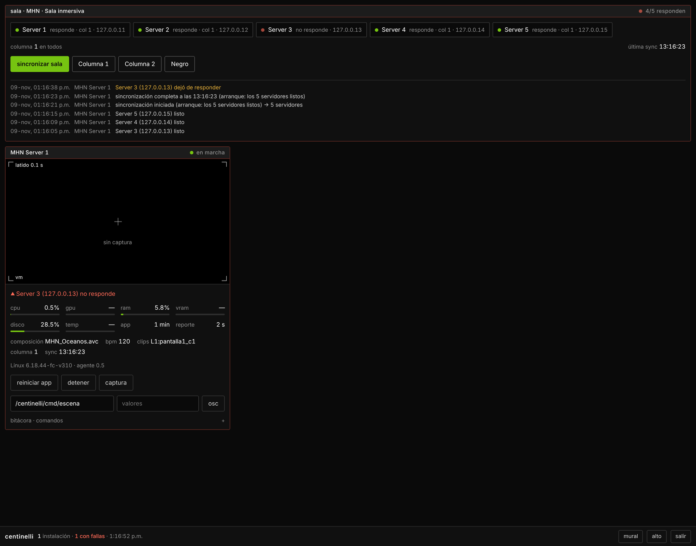
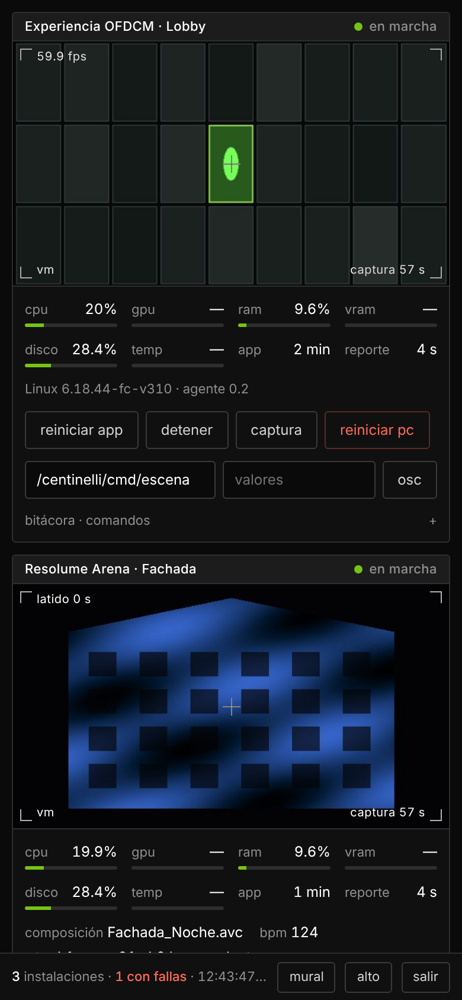
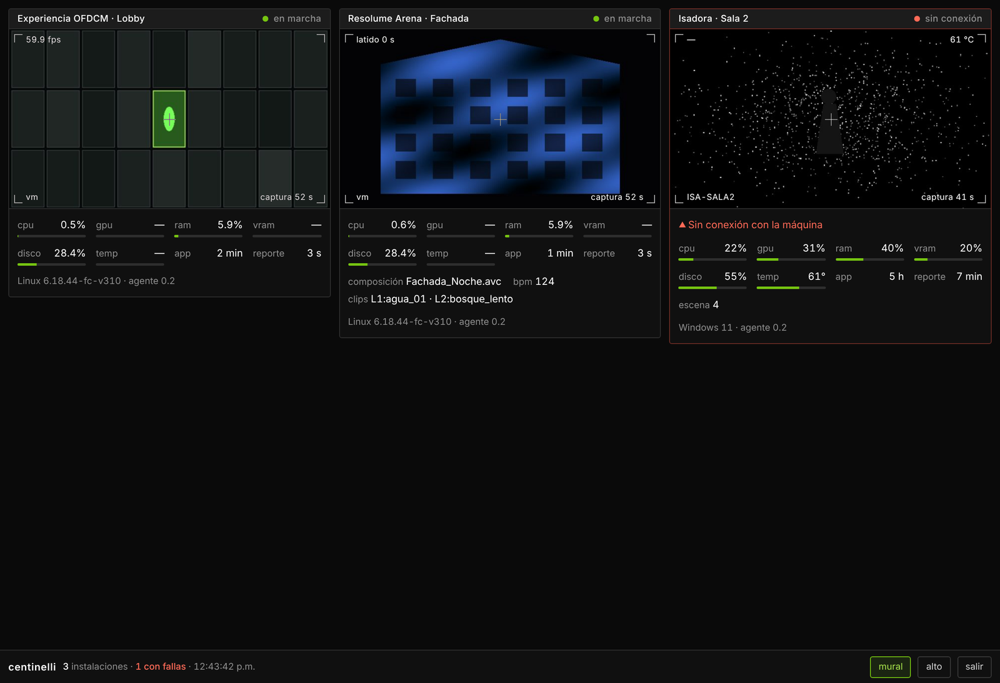
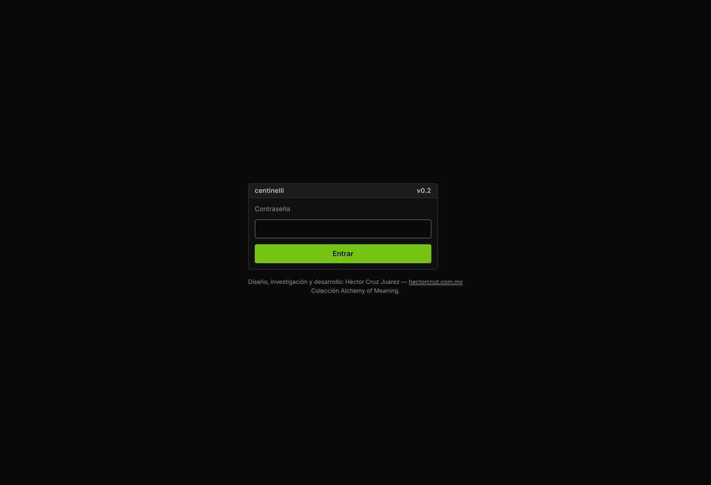
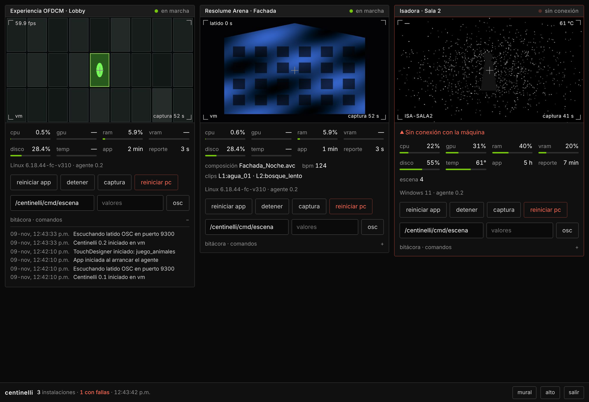
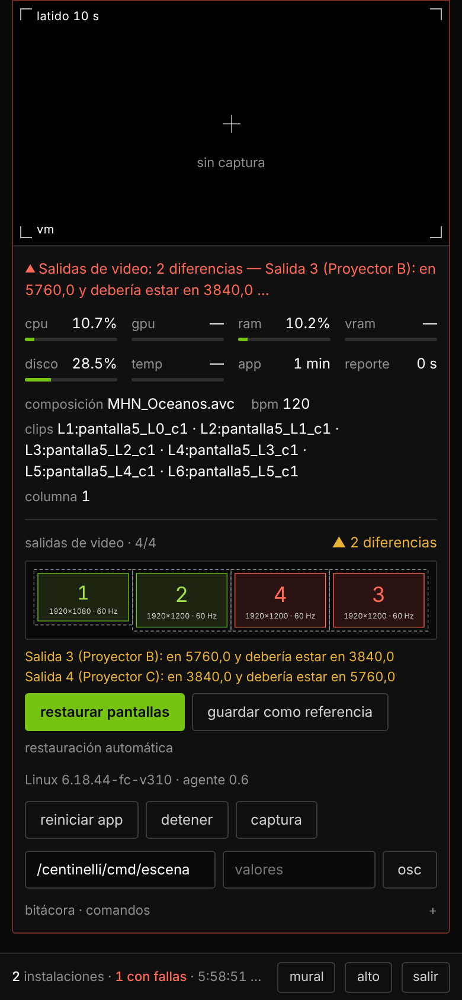
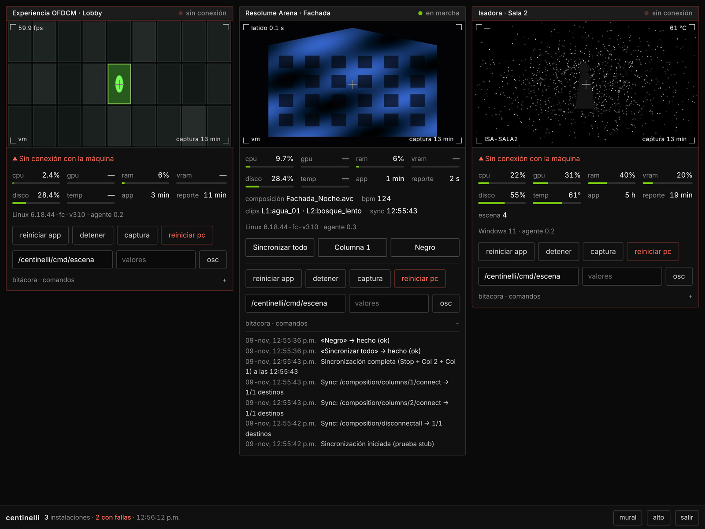

# Centinelli

**Monitoreo y control remoto de instalaciones multimedia hechas con TouchDesigner, Isadora o Resolume Arena.**

Centinelli vigila la computadora de una instalación mientras tú no estás. Sabe si la pieza sigue viva, la reinicia si se cae o se congela y te avisa por Telegram. Desde el teléfono puedes verla en miniatura y mandarle comandos.

Versión 0.6 · prototipo · Colección Alchemy of Meaning (Alquimia del Significado)



## Qué hace

- **Vigila el proceso** (TouchDesigner, Isadora, Arena) y lo relanza si se cierra.
- **Detecta congelamientos.** La app manda un latido OSC; en Resolume, el agente consulta su REST API. Si el latido deja de llegar con la ventana abierta, el agente mata la app y la vuelve a abrir. Si se reinicia demasiadas veces en una hora, se detiene y te avisa.
- **Reporta** fps, CPU, GPU, RAM, VRAM, temperatura, disco y los valores que mande la pieza (escena, jugadores; en Resolume: composición, BPM y clips conectados). Además manda una miniatura de la pantalla cada minuto.
- **Recibe comandos** desde el dashboard: reiniciar la app (reiniciar la PC está desactivado por defecto), pedir una captura o mandar cualquier mensaje OSC a la pieza (cambiar de escena, disparar una columna de Arena).
- **Botones de cue** por instalación («Sincronizar todo», «Columna 1», «Negro»), definidos en la máquina.
- **Sincroniza varios Resolume sin TouchDesigner.** Los agentes de una *sala* se mandan entre ellos la secuencia Negro → Columna 2 → Columna 1: al encender, cuando un Arena se reabre, a ciertas horas o con un botón. El dashboard muestra la columna activa de cada server y avisa si hay desfase Puede ir **en una sola máquina** que vigila a las demás por el REST API de Resolume y sincroniza cuando todas terminaron de arrancar (ver [INSTALAR-SERVER1.md](INSTALAR-SERVER1.md) y [SALA.md](resolume/SALA.md)).
- **Vigila las salidas de video.** Si Windows reacomoda los displays (un proyector que entra en standby, un HDMI que parpadea), lo detecta por puerto físico, lo restaura y reabre Arena. Si una salida desaparece, avisa (ver [PANTALLAS.md](PANTALLAS.md)).
- **Avisa** por Telegram o correo si una máquina pierde conexión, si la app falla más de 45 s o si el GPU se calienta. También avisa cuando se resuelve.
- **No abre puertos.** La máquina sólo hace conexiones de salida por HTTPS, así que funciona detrás del firewall de museos y teatros.

| Teléfono | Modo mural (`h`) | Acceso |
|---|---|---|
|  |  |  |







## Cómo está hecho

```
agente/          Python (psutil): corre en cada máquina, vigila y reporta
servidor/        PHP sin base de datos: API, dashboard, alertas (sube a cualquier hosting compartido)
touchdesigner/   script que construye el COMP «centinelli» + resolume_sync_v3 (sincronización de varios Arena)
isadora/         guía: escena de fondo con latido OSC y comandos
resolume/        guía y config: latido por REST API, comandos por OSC
```

## Uso rápido

Para una primera prueba en una sola computadora, sigue **[PRUEBA-LOCAL.md](PRUEBA-LOCAL.md)**. Para una sala de varios Resolume con Centinelli sólo en el primer server, **[INSTALAR-SERVER1.md](INSTALAR-SERVER1.md)**.

1. Sube `servidor/` a tu hosting, copia `config.example.php` como `config.php` y genera contraseña y token con `hash.php`.
2. En la máquina: `pip install psutil mss pillow`, copia la plantilla de `agente/` que corresponda como `config.json` y ejecuta `python centinelli_agente.py config.json`.
3. En la pieza: el COMP de TouchDesigner, la escena de latido de Isadora o el webserver de Arena.

La guía completa de instalación está en **[LEEME.md](LEEME.md)**. Incluye la lista para dejar una máquina funcionando sola: BIOS, Windows, no-break y acceso de emergencia.

## Estado

Prototipo. El ciclo completo (agente, servidor, alertas y comandos) está probado con apps simuladas. La integración dentro de TouchDesigner, Isadora y Resolume falta probarla en producción.

## Créditos

Diseño, investigación y desarrollo: **Héctor Cruz Juárez** — https://hectorcruz.com.mx
Colección **Alchemy of Meaning (Alquimia del Significado)**. Interfaz con el estilo alchemy-ui v1.
Licencia GPL-3.0.

---

## English

**Remote monitoring and control for media installations built with TouchDesigner, Isadora or Resolume Arena.**

Centinelli watches an installation computer while you are away. It knows whether the piece is still running, restarts it when it crashes or freezes, and alerts you on Telegram. From your phone you can see a thumbnail and send it commands.

Version 0.6 · prototype · Alchemy of Meaning collection

### What it does

- **Watches the process** (TouchDesigner, Isadora, Arena) and relaunches it if it closes.
- **Detects freezes.** The app sends an OSC heartbeat; for Resolume, the agent polls its REST API. If the heartbeat stops while the window is still open, the agent kills and relaunches the app. After too many restarts in an hour it stops and alerts you.
- **Reports** fps, CPU, GPU, RAM, VRAM, temperature, disk and any values the piece sends (scene, players; for Resolume: composition, BPM and connected clips). It also sends a screen thumbnail every minute.
- **Takes commands** from the dashboard: restart the app or the PC, take a screenshot, or send any OSC message to the piece (change scene, trigger an Arena column).
- **Cue buttons** per installation, defined on each machine.
- **Keeps several Resolume servers in sync without TouchDesigner.** The agents in a *room* send each other the sync sequence: at power-on, when an Arena is reopened, on a schedule, or from a button. The dashboard shows each server's active column and flags drift.
- **Watches video outputs.** If Windows reshuffles the displays, it detects it per physical port, restores the layout and reopens Arena; if an output disappears, it alerts you.
- **Alerts** by Telegram or email when a machine goes offline, the app fails for more than 45 s, or the GPU runs hot. It also tells you when the problem clears.
- **Opens no ports.** The machine only makes outbound HTTPS requests, so it works behind museum and theatre firewalls.

### Layout

`agente/` Python agent (psutil) · `servidor/` database-free PHP server (API, dashboard, alerts) · `touchdesigner/` script that builds the «centinelli» COMP · `isadora/` heartbeat scene guide · `resolume/` REST-API heartbeat + OSC commands.

### Quick start

1. Upload `servidor/` to any PHP host, copy `config.example.php` to `config.php`, and generate a password and token with `hash.php`.
2. On the machine, run `pip install psutil mss pillow`, copy the matching template from `agente/` to `config.json`, then run `python centinelli_agente.py config.json`.
3. In the piece, add the TouchDesigner COMP, the Isadora heartbeat scene, or enable Arena's webserver.

The full setup guide (in Spanish) is in [LEEME.md](LEEME.md).

### Credits

Design, research and development: **Héctor Cruz Juárez** — https://hectorcruz.com.mx
**Alchemy of Meaning (Alquimia del Significado)** collection. Licensed under GPL-3.0.
